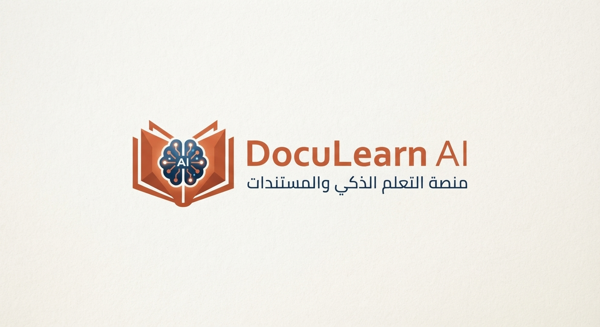
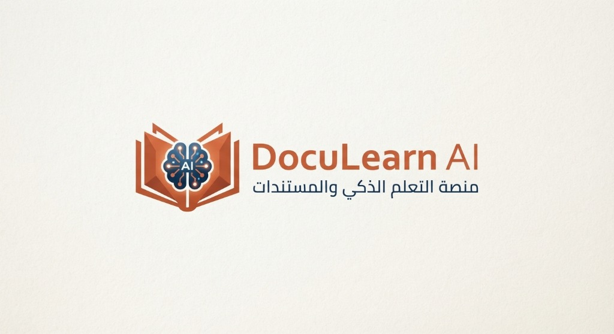
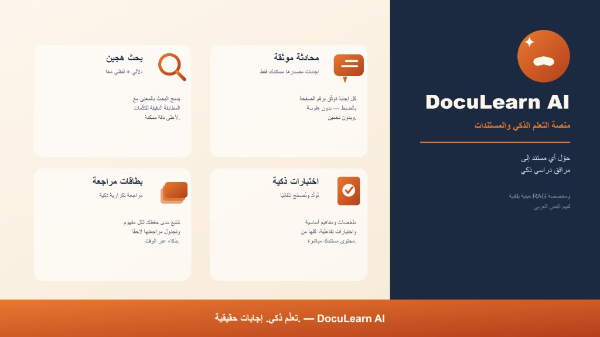
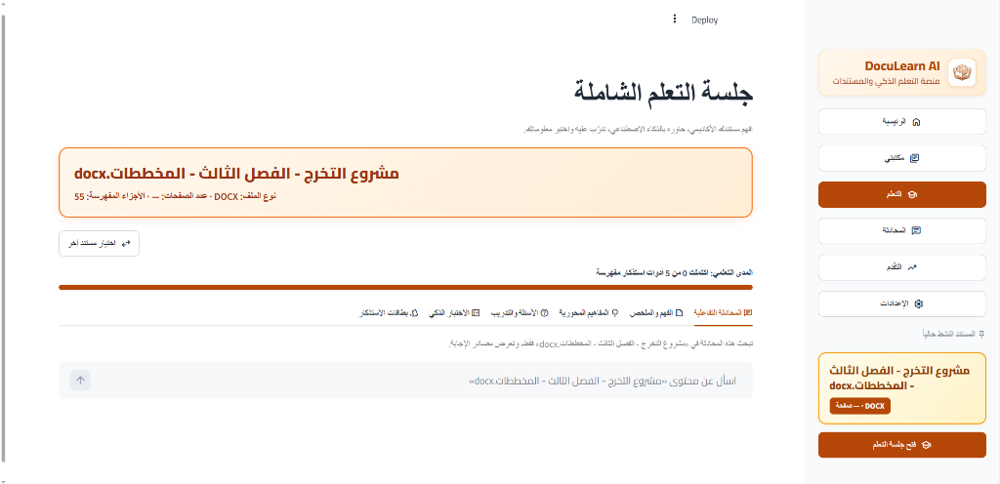
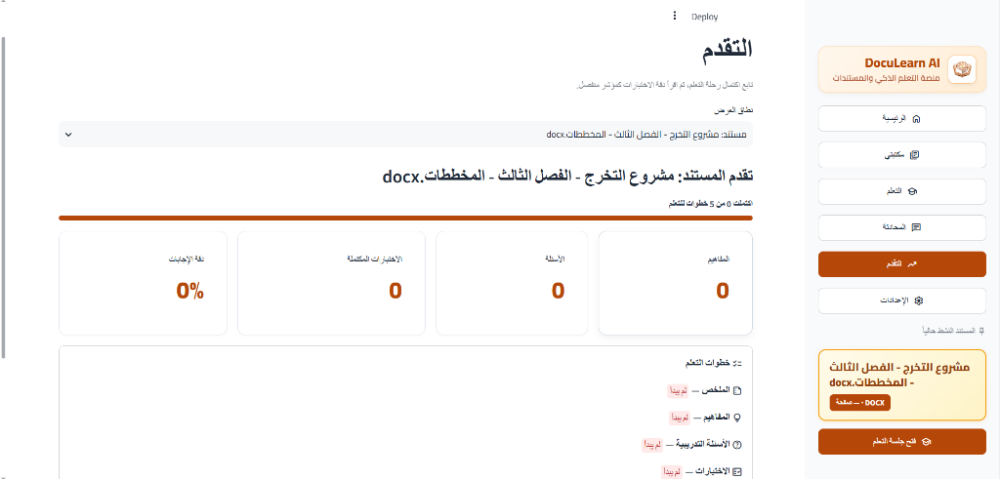

<div align="center">





# 🎓 DocuLearn AI
### Smart Document Learning & Hybrid RAG Platform
### منصة التعلّم الذكي وإدارة المستندات بالذكاء الاصطناعي

[](https://www.python.org/)
[](https://streamlit.io/)
[](#-architecture--data-flow)
[](https://github.com/facebookresearch/faiss)
[](https://ai.google.dev/)
[](#-tests--verification)
[](LICENSE)

<br/>

<p align="center">
  <a href="#-english-version">English Documentation</a> &nbsp;•&nbsp;
  <a href="#-النسخة-العربية">التوثيق العربي</a>
</p>



</div>

---

<br/>

# 🌐 English Version

## 📌 Overview

**DocuLearn AI** is an advanced AI-powered educational document learning platform engineered with **Clean Architecture** and **Domain-Driven Design (DDD)**. It bridges the gap between static educational resources (PDF, DOCX, XLSX, TXT) and active personalized learning by providing **source-grounded conversational Q&A** and an **AI Learning Engine** that synthesizes summaries, extracts core concepts, creates quizzes, and builds spaced-repetition flashcards.

---

## ✨ Key Capabilities

1. **Smart Document Ingestion & Quality Analysis**:
   - Multi-format text extraction (PDF via PyMuPDF, Word via python-docx, Excel via openpyxl, TXT).
   - Specialized **Arabic Text Normalization** (`ArabicNormalizer`) removing diacritics, tatweel, and standardizing forms.
   - Automatic text health detection (`TextQualityAnalyzer`) to identify scanned files needing OCR.

2. **Hybrid RAG Retrieval Engine**:
   - **Dense Semantic Retrieval**: SentenceTransformers (`all-MiniLM-L6-v2`) + **FAISS** vector indexing.
   - **Lexical Keyword Retrieval**: Arabic-optimized **BM25** matching.
   - **Score Fusion**: Algorithmic fusion using **RRF (Reciprocal Rank Fusion)** and weighted score normalization.

3. **Grounded & Hallucination-Resistant Q&A**:
   - Pre-generation **Context Sufficiency Evaluation** to ensure questions are answered strictly from the source.
   - Exact citation with **document name and page number**.
   - Out-of-context detection with fallback to general AI chat when requested.

4. **Interactive AI Learning Engine**:
   - **Multi-Level Summaries**: Comprehensive, executive, and key bullet points.
   - **Key Concept Extraction**: Domain terms, definitions, and chapter insights.
   - **Smart Quizzes & Self-Assessment**: Automated MCQ, True/False, and short-answer generation with real-time scoring and feedback.
   - **Spaced-Repetition Flashcards**: Interactive digital flashcards to retain vocabulary and facts.

5. **Course Organization & Analytics Dashboard**:
   - Strict course and document data isolation.
   - Real-time progress monitoring, score tracking, and study analytics.

---

## 🏛️ Architecture & Data Flow

```text
┌─────────────────────────────────────────────────────────────┐
│                 Streamlit Presentation Layer                │
│    (Dashboard / Library / Study Session / Chat / Progress)  │
└──────────────────────────────┬──────────────────────────────┘
                               │
┌──────────────────────────────▼──────────────────────────────┐
│                  Application Layer (Facade)                 │
│  PlatformService • DocumentProcessingPipeline • QAService   │
└──────────────────────────────┬──────────────────────────────┘
                               │
┌──────────────────────────────▼──────────────────────────────┐
│                    Domain Layer (Pure DDD)                  │
│       Entities (Document, Chunk, Course, Quiz, Flashcard)   │
│             Repository & Provider Interfaces                │
└──────────────────────────────┬──────────────────────────────┘
                               │
               ┌───────────────┴───────────────┐
               │                               │
┌──────────────▼──────────────┐ ┌──────────────▼──────────────┐
│   Infrastructure Services   │ │      External AI APIs       │
│  SQLite • FAISS VectorStore │ │ Google Gemini LLM Provider  │
│  SentenceTransformers Embed │ │                             │
└─────────────────────────────┘ └─────────────────────────────┘
```

---

## 📸 Screenshots & Application Tour

<div align="center">

### 1. Interactive Study Session & Grounded Chat
*Active document learning hub featuring real-time conversational Q&A, source citations, summaries, quizzes, and flashcards.*
<br/>


<br/><br/>

### 2. Learning Progress & Analytics Dashboard
*Comprehensive tracking of document completion, accuracy rates, mastered concepts, and quiz scores.*
<br/>


<br/><br/>

### 3. Document Library & Course Hub
*Unified file intake supporting PDF, Word, Excel, and TXT with indexing status indicators.*
<br/>


</div>

---

## 🛠️ Prerequisites & Tech Stack

* **Operating System**: Windows, Linux, or macOS.
* **Python**: `3.10` or higher (`3.11` recommended).
* **Gemini API Key**: Obtain a free key from [Google AI Studio](https://aistudio.google.com/).

### Technologies:
* **Frontend**: Streamlit
* **Vector Database**: FAISS (Facebook AI Similarity Search)
* **Embedding Model**: `sentence-transformers` (`all-MiniLM-L6-v2`)
* **LLM Engine**: Google Gemini via official `google-genai` SDK
* **Relational Database**: SQLAlchemy + SQLite

---

## 🚀 Step-by-Step Installation & Setup

### 1. Clone Repository & Setup Virtual Environment
```bash
# Clone the repository
git clone https://github.com/YOUR_USERNAME/DocuLearn-AI.git
cd DocuLearn-AI

# Create virtual environment
python -m venv .venv

# Activate virtual environment
# On Windows (PowerShell):
.venv\Scripts\Activate.ps1
# On Linux/macOS:
source .venv/bin/activate
```

### 2. Install Required Dependencies
```bash
pip install -r requirements.txt
```

### 3. Configure Environment Variables
Copy the template `.env.example` to create your local `.env` file:
```bash
cp .env.example .env
```
Open `.env` and fill in your Gemini API key:
```env
APP_NAME="DocuLearn AI"
ENVIRONMENT="development"
DATABASE_URL="sqlite:///data/app.db"
UPLOADS_DIR="data/uploads"
VECTOR_STORE_PATH="data/vector_store"

EMBEDDING_MODEL="all-MiniLM-L6-v2"
LLM_PROVIDER="gemini"
LLM_MODEL="gemini-3.5-flash"
GEMINI_API_KEY="AIzaSy...your_gemini_api_key_here"

CHUNK_SIZE=1000
CHUNK_OVERLAP=150
TOP_K=5
RAG_MIN_CONTEXT_SCORE=0.42
MAX_UPLOAD_SIZE_MB=50
LOG_LEVEL="INFO"
```

### 4. Run System Health Diagnostics
Verify your environment and components before running:
```bash
python -m app.health
```
Expected output:
```json
{
  "status": "healthy",
  "database": true,
  "vector_store": true,
  "embedding_provider": true,
  "llm_configured": true
}
```

### 5. Launch Application
```bash
streamlit run app/main.py
```
Open your browser at: **`http://localhost:8501`**

---

## 🧪 Tests & Verification

The project includes full unit and integration test coverage:
```bash
pytest tests -v
```
**Test Results**:
* **276 PASSED**
* **0 FAILED**
* **7 SKIPPED** (Optional external integration tests)

---

<br/><br/>

# 🇸🇦 النسخة العربية

## 📌 عن المشروع

**DocuLearn AI** هو منصة تعليمية تفاعلية متقدمة ومبنية بأحدث تقنيات الذكاء الاصطناعي ومعمارية البرمجيات النظيفة (**Clean Architecture / DDD**). 

يهدف النظام إلى حل مشكلة جمود المستندات والمقررات الأكاديمية (PDF, Word, Excel, TXT) وتحويلها إلى **مرافق دراسي شخصي تفاعلي**؛ يتيح للطالب التحدث المباشر مع محتوى محاضراته، الحصول على إجابات موثقة برقم الصفحة بدقة، وتوليد حزم مراجعة متكاملة من ملخصات ومفاهيم واختبارات وبطاقات استذكار تقيس التقدم الأكاديمي.

---

## ✨ أبرز الميزات التقنية

1. **معالجة متقدمة وتطبيع خاص باللغة العربية (`ArabicNormalizer`)**:
   * تطبيع دقيق لحروف الألف، الهمزات، الياء، والتاء المربوطة.
   * إزالة التشكيل والتطويل دون التأثير على صحة المعنى لضمان استرجاع عالي الدقة.
   * تحليل جودة النصوص المستخرجة لاكتشاف الملفات الممسوحة ضوئياً التي تحتاج إلى OCR.

2. **محرك بحث واسترجاع هجين (Hybrid RAG Retrieval)**:
   * **بحث دلالي متجهي**: باستخدام نموذج التضمين `SentenceTransformers` (`all-MiniLM-L6-v2`) وفهرس `FAISS`.
   * **بحث لفظي معرب**: يعتمد على خوارزمية `BM25` للبحث بالمطابقة الدقيقة للكلمات المفتاحية.
   * **انصهار ذكي للنتائج**: دمج البحثين باستخدام خوارزميات **RRF (Reciprocal Rank Fusion)** لترتيب أدق السياقات.

3. **إجابات موثقة ومنع تام للهلوسة (Zero Hallucination)**:
   * تقييم كفاية السياق (`Context Sufficiency`) قبل التوليد.
   * استخراج الإجابات حصراً من المستند مع ذكر **رقم الصفحة والمقتطف النصي**.
   * عند خروج السؤال عن سياق المنهج، يرفض النظام التخمين ويوفر زراً للتحويل الاختياري إلى الذكاء الاصطناعي العام.

4. **محرك التعلم الذكي التفاعلي**:
   * **ملخصات متعددة المستويات**: شاملة، تنفيذية، ونقاط محورية.
   * **المفاهيم المحورية**: استخراج المصطلحات والتعريفات الأساسية لكل فصل.
   * **اختبارات ذاتية تفاعلية**: توليد أسئلة اختيار من متعدد، صح/خطأ، ومقالية مع تصحيح فوري وتغذية راجعة.
   * **بطاقات الاستذكار (Flashcards)**: بنظام التكرار المتباعد لترسيخ المعلومات.

5. **لوحة تحكم ومتابعة التقدم**:
   * قياس نسب الإتقان لكل مستند ومادة دراسية.
   * عزل تام للبيانات بين المستندات والمقررات (`Document Isolation`).

---

## 📸 جولة في واجهات المنصة

<div align="center">

### 1. جلسة التعلم الشاملة والمحادثة الموثقة
*المساحة التفاعلية للدراسة؛ محادثة ذكية مع المستند، استعراض المراجع، توليد الملخصات، وخوض الاختبارات.*
<br/>


<br/><br/>

### 2. لوحة التقدم والتحليلات الأكاديمية
*متابعة دقيقة لنسبة إتقان المستند، دقة إجابات الاختبارات، المفاهيم المحفوظة، وساعات الاستذكار.*
<br/>


<br/><br/>

### 3. مكتبة المستندات وإدارة المقررات
*إدارة ورفع الملفات بصيغ PDF, Word, Excel, TXT مع مؤشرات حالة الفهرسة والمعالجة.*
<br/>


</div>

---

## 💻 متطلبات التشغيل

* نظام تشغيل: Windows أو Linux أو macOS.
* لغة **Python 3.10** أو أحدث (`Python 3.11` موصى بها).
* مفتاح مجاني لـ **Google Gemini API** (يمكن الحصول عليه مجاناً عبر [Google AI Studio](https://aistudio.google.com/)).

---

## 🚀 دليل التثبيت والتشغيل المحلي خطوة بخطوة

### الخطوة 1: استنساخ المشروع وإنشاء البيئة الافتراضية
```bash
# استنساخ المستودع
git clone https://github.com/YOUR_USERNAME/DocuLearn-AI.git
cd DocuLearn-AI

# إنشاء بيئة بايثون افتراضية
python -m venv .venv

# تفعيل البيئة:
# على ويندوز (PowerShell):
.venv\Scripts\Activate.ps1
# على لينكس أو ماك:
source .venv/bin/activate
```

### الخطوة 2: تثبيت المكتبات المطلوبة
```bash
pip install -r requirements.txt
```

### الخطوة 3: إعداد ملف المتغيرات `.env`
انسخ الملف النموذجي `.env.example` لإنشاء ملفك المحلي:
```bash
cp .env.example .env
```
ضع مفتاح الـ API الخاص بك في ملف `.env`:
```env
GEMINI_API_KEY="ضع_مفتاحك_هنا"
```

### الخطوة 4: فحص جاهزية النظام (Health Check)
```bash
python -m app.health
```
ستظهر رسالة النجاح بتوافق قاعدة البيانات، وفهرس المتجهات، ونموذج التضمين، والـ LLM.

### الخطوة 5: تشغيل المنصة
```bash
streamlit run app/main.py
```
افتح المتصفح على الرابط: **`http://localhost:8501`**

---

## 🧪 الاختبارات البرمجية المعتمدة

تم تأكيد سلامة جميع وحدات النظام برمجياً:
```bash
pytest tests -v
```
* **276 اختبار ناجح بنسبة 100% (PASSED)**
* **0 اختبار فاشل (FAILED)**

---

## 👥 فريق العمل والمساهمون (Contributors)

* تم تطوير هذا المشروع كعمل جماعي متميز لمادة **مقدمة في الذكاء الاصطناعي (Introduction to AI)**.

---

## 📄 الترخيص (License)

هذا المشروع مرخص تحت رخصة **MIT** — متاح للاستخدام الأكاديمي والتعليمي والتطوير البرمجي.
